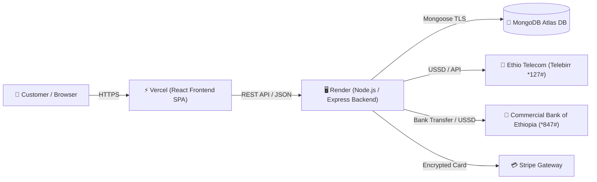

# 🚀 Complete Production Deployment Guide: Frontend on Vercel & Backend on Render

This guide walks you through deploying the modernized **E-Commerce Web Application** with full Ethiopian local payments (**Telebirr** & **Commercial Bank of Ethiopia - CBE**) and international cards (**Stripe**) into a production-grade architecture:

- **Frontend**: Single Page Application (SPA) deployed on **Vercel** with worldwide edge CDN.
- **Backend**: RESTful Express API deployed on **Render** as a high-availability Web Service.
- **Database**: Cloud MongoDB database hosted on **MongoDB Atlas**.

---

## 🏗️ Architecture Overview



---

## 📋 Prerequisites Checklist

1. [GitHub](https://github.com/) account with this repository pushed.
2. [MongoDB Atlas](https://www.mongodb.com/cloud/atlas) free or dedicated account.
3. [Render](https://render.com/) account.
4. [Vercel](https://vercel.com/) account.
5. (Optional) [Stripe](https://stripe.com/) account if accepting international cards.

---

## 🍃 Step 1: Set Up MongoDB Atlas Database

1. **Sign in to MongoDB Atlas** at [cloud.mongodb.com](https://cloud.mongodb.com).
2. **Create a Database Cluster**:
   - Select **M0 Free Tier** (Shared).
   - Choose a cloud provider and region close to your Render deployment (e.g., `AWS / Frankfurt` or `AWS / N. Virginia`).
3. **Configure Network Access**:
   - Go to **Security** ➔ **Network Access**.
   - Click **Add IP Address**.
   - Select **Allow Access from Anywhere** (`0.0.0.0/0`) because Render assigns dynamic outbound IPs.
   - Click **Confirm**.
4. **Create a Database User**:
   - Go to **Security** ➔ **Database Access**.
   - Click **Add New Database User**.
   - Choose **Password Authentication**.
   - Set Username (e.g., `ecommerce_admin`) and a secure password.
   - Grant role: **Read and write to any database**.
5. **Get Connection String**:
   - Go to **Deployment** ➔ **Database**.
   - Click **Connect** ➔ **Drivers** (Node.js).
   - Copy your connection string:
     ```text
     mongodb+srv://ecommerce_admin:<password>@cluster0.xxxxx.mongodb.net/ecommerce?retryWrites=true&w=majority
     ```
   - Replace `<password>` with your database user password.

---

## 🖥️ Step 2: Deploy the Backend on Render

You can deploy using either the automated **Render Blueprint** (`render.yaml`) or the **Render Dashboard**.

### Option A: 1-Click Render Blueprint (Recommended)

1. Sign in to [Render Dashboard](https://dashboard.render.com).
2. Click **New +** in the top right ➔ **Blueprint**.
3. Connect your GitHub repository.
4. Render will automatically detect [`render.yaml`](file:///home/borifan/E-commerce/E_commerce_website/render.yaml).
5. Fill in the required environment variables:
   - `MONGODB_URI`: Paste your MongoDB Atlas connection string.
   - `CLIENT_URL`: `https://your-app-name.vercel.app` (or leave blank until Step 3).
6. Click **Apply**. Render will build and deploy the web service.

---

### Option B: Manual Web Service Setup on Render

1. Sign in to [dashboard.render.com](https://dashboard.render.com).
2. Click **New +** ➔ **Web Service**.
3. Connect your repository.
4. Configure the settings:

| Setting | Value |
| :--- | :--- |
| **Name** | `ecommerce-api` |
| **Region** | Oregon (US West) or Frankfurt (EU Central) |
| **Branch** | `main` (or `master`) |
| **Root Directory** | `backend` |
| **Runtime** | `Node` |
| **Build Command** | `npm install --production=false` |
| **Start Command** | `node server.js` |
| **Health Check Path** | `/api/health` |
| **Instance Type** | Free (or Starter for 24/7 zero-sleep) |

5. Under **Environment Variables**, add:

| Key | Example Value | Description |
| :--- | :--- | :--- |
| `NODE_ENV` | `production` | Enables production optimizations & security |
| `PORT` | `5000` | Port listened by the Express server |
| `MONGODB_URI` | `mongodb+srv://...` | Your Atlas connection URI |
| `JWT_SECRET` | `generate-a-strong-secret-key-32-chars` | Signing key for authentication tokens |
| `JWT_EXPIRE` | `30d` | Token expiry duration |
| `CLIENT_URL` | `https://your-frontend.vercel.app` | Allowed CORS frontend origin |
| `ETB_EXCHANGE_RATE` | `120.0` | 1 USD to ETB conversion rate |
| `TELEBIRR_MERCHANT_PHONE`| `0911223344` | Merchant Telebirr phone number |
| `TELEBIRR_MERCHANT_NAME` | `E-Store Official Ethiopia` | Official account display name |
| `CBE_ACCOUNT_NUMBER` | `1000123456789` | Commercial Bank of Ethiopia account number |
| `CBE_ACCOUNT_NAME` | `E-Store Retail PLC` | CBE account beneficiary name |
| `STRIPE_SECRET_KEY` | `sk_test_...` *(optional)* | Stripe secret key (mock mode active if empty) |

6. Click **Create Web Service**.
7. Once deployed, test your backend URL:
   - **Health Check**: `https://ecommerce-api.onrender.com/api/health` (should return `{ "status": "healthy", ... }`)
   - **Swagger API Docs**: `https://ecommerce-api.onrender.com/api/docs`

---

## ⚡ Step 3: Deploy the Frontend on Vercel

1. Sign in to [vercel.com](https://vercel.com).
2. Click **Add New...** ➔ **Project**.
3. Import your GitHub repository.
4. Configure Project Settings:

| Setting | Value | Notes |
| :--- | :--- | :--- |
| **Framework Preset** | `Create React App` | Automatically detected |
| **Root Directory** | `frontend` | ⚠️ **Click "Edit" and choose `frontend`** |
| **Build Command** | `npm run build` | Default |
| **Output Directory** | `build` | Default |

5. Under **Environment Variables**, add:

| Key | Value | Notes |
| :--- | :--- | :--- |
| `REACT_APP_API_URL` | `https://ecommerce-api.onrender.com` | **Your Render Backend URL** (no trailing slash) |
| `REACT_APP_STRIPE_PUBLISHABLE_KEY` | `pk_test_...` | Optional (sample test key pre-configured) |

6. Click **Deploy**.
7. In about 60–90 seconds, your application will be live at `https://your-app-name.vercel.app`!

> [!NOTE]
> Client-side routing is handled by [`frontend/vercel.json`](file:///home/borifan/E-commerce/E_commerce_website/frontend/vercel.json). Deep links such as `/products`, `/orders`, `/checkout`, and `/admin` will automatically rewrite to `index.html` without 404 errors.

---

## 🔄 Step 4: Final Linkage (CORS & Environment Sync)

Now that both URLs are known:

1. Copy your Vercel URL (e.g., `https://ecommerce-store-borifan.vercel.app`).
2. Go to **Render Dashboard** ➔ `ecommerce-api` ➔ **Environment**.
3. Update `CLIENT_URL` to your exact Vercel URL:
   ```text
   CLIENT_URL = https://ecommerce-store-borifan.vercel.app
   ```
4. Click **Save Changes**. Render will automatically re-deploy with updated CORS rules.

---

## 🌱 Step 5: Seed Products, Admin Account & Coupons

To populate your production database with 20 initial catalog products, an administrator account, and promotional coupons:

### Method 1: Using Render Shell (Recommended)

1. Open **Render Dashboard** ➔ `ecommerce-api`.
2. Click the **Shell** tab on the left.
3. Run the following command:
   ```bash
   node utils/seeder.js -d && node utils/seeder.js -i
   ```
4. Output will confirm:
   ```text
   Data Destroyed...
   Data Imported: 20 Products, 1 Admin User, 3 Coupons!
   ```

### Method 2: Locally Against Atlas

Run from your local terminal with your Atlas URI:
```bash
cd backend
MONGODB_URI="your_mongodb_atlas_uri" node utils/seeder.js -i
```

---

## 🔑 Default Credentials & Active Coupons

### Default Administrator Login
- **URL**: `https://your-app.vercel.app/login`
- **Email**: `admin@ecommerce.com`
- **Password**: `admin123456`
- **Role**: `admin` (Full access to `/admin`, `/admin/products`, `/admin/orders`, `/admin/analytics`)

### Active Promotional Coupons
Customers can enter these codes at checkout:
- `WELCOME10`: **10% OFF** on any order over \$50.
- `SUPER20`: **\$20 FLAT OFF** on any order over \$100.
- `FLAT15`: **\$15 FLAT OFF** on any order over \$75.

---

## 💳 Testing Ethiopian Payment Integrations

### 1. Telebirr Payment
1. Add items to cart and proceed to Checkout (`/checkout`).
2. Enter delivery address in Addis Ababa or any region.
3. Select **telebirr (Ethio Telecom)** as payment method.
4. Click **Proceed to Telebirr Payment**.
5. Step 2 will show:
   - Converted Ethiopian Birr amount (e.g. `2,400.00 ETB`) and USD price.
   - Merchant Phone (`0911223344`) with one-click copy.
   - Payment Reference (`TLB-XXXXXX`) with one-click copy.
   - USSD Quick Dial string (`*127*1*0911223344*<amount>#`).
6. Enter customer phone number and transaction ID (e.g. `TLB98273618`).
7. Click **Confirm & Verify Payment**. The order is immediately verified and placed in `processing` status.

### 2. Commercial Bank of Ethiopia (CBE)
1. At Checkout, select **Commercial Bank of Ethiopia (CBE / CBE Birr)**.
2. Step 2 will display:
   - Account Number: `1000123456789` (E-Store Retail PLC).
   - Branch: Addis Ababa Main Branch.
   - CBE Birr USSD code: `*847#`.
   - Transfer Remark / Slip Code: `CBE-XXXXXX`.
3. Enter transaction reference number (e.g. `FT24098192837`).
4. Click **Verify & Confirm Payment**. The order is instantly updated to paid.

---

## 🛠️ Diagnostics & Maintenance

- **Health Check**:
  `GET https://ecommerce-api.onrender.com/api/health`
  Returns MongoDB connection state, uptime, memory usage, and process status.
- **OpenAPI Specification**:
  `GET https://ecommerce-api.onrender.com/api/docs.json`
- **Interactive Swagger Documentation**:
  Visit `https://ecommerce-api.onrender.com/api/docs` in your browser.

